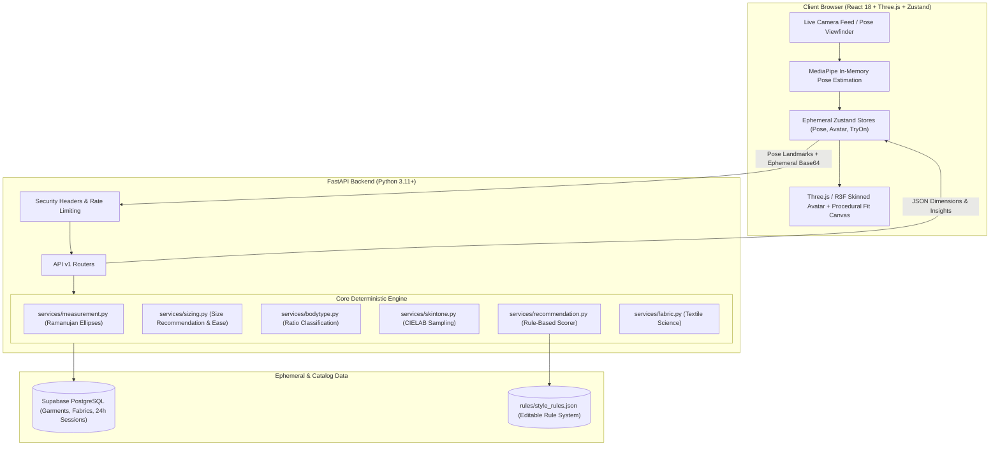

# StyleMirror: System Architecture

---

## 1. Zero-Storage Privacy Architecture
* **In-Memory Processing:** Photos captured during the 4-angle guided scan are parsed in volatile RAM only, never written to disk or uploaded to S3/GCS buckets.
* **Anonymous Sessions:** Identified by random UUID with a strictly enforced 24-hour expiration window.
* **Cascading Instant Purge:** The `DELETE /api/v1/sessions/me` endpoint enables instant user-initiated data deletion.

---

## 2. 3D Avatar & Garment Fitting Strategy
* **Avatar Pipeline:** Uses a parameterized skeleton model rigged with bone morphing corresponding to 7 primary physical anthropometric landmarks (height, shoulder breadth, chest, waist, hip, torso length, inseam).
* **Garment Fitting:** Each size variant (XS–XXL) binds to the avatar's bone hierarchy without non-deterministic real-time cloth physics.
* **Material Customization:** Garment colorways are applied directly by mutating Three.js PBR shader values (`material.color`), eliminating redundant model downloads.

---

## 3. Explainable Style Advisory Engine
* **Rule-based Decoupling:** Scoring parameters, neckline affinities, and chromatic harmony values reside in [`apps/api/app/rules/style_rules.json`](file:///c:/Users/asus4/Desktop/New%20Gen%20Project/stylemirror/apps/api/app/rules/style_rules.json), making logic editable without code deployment.
* **Positive Reasoning:** Every recommendation is accompanied by 2–3 affirmative reasons and transparent fabric performance insights.
