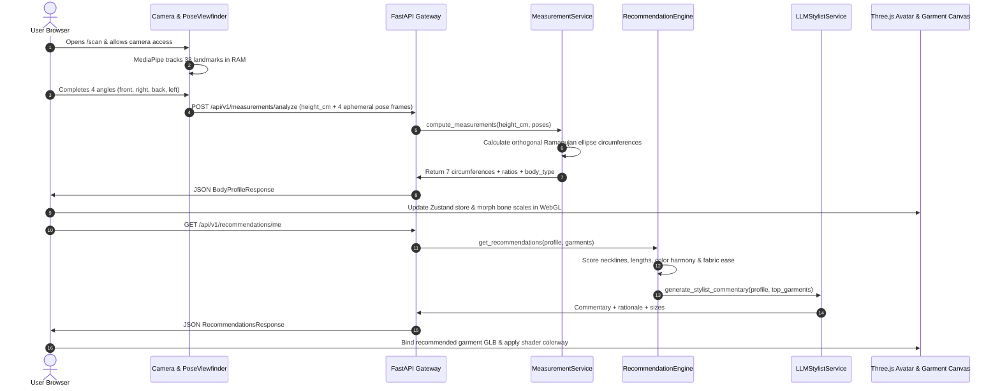

# StyleMirror: Code Flow & Execution Architecture

This document provides a precise, function-by-function trace of how code executes across StyleMirror, from client-side capture through numerical calculations to 3D rendering and recommendation delivery.

---

## 1. High-Level System Flow

---

## 2. Detailed Execution Flows by Subsystem

### Flow A: Camera Capture & Viewfinder Alignment
* **Primary Entrypoint:** [`apps/web/src/features/capture/CameraPoseViewfinder.tsx`](file:///c:/Users/asus4/Desktop/New%20Gen%20Project/stylemirror/apps/web/src/features/capture/CameraPoseViewfinder.tsx)
* **Execution Order & Function Hierarchy:**
  1. `useCameraStream()` initializes `navigator.mediaDevices.getUserMedia({ video: { facingMode: "user", width: 1280, height: 720 } })`.
  2. `initMediaPipePose()` loads `@mediapipe/pose` WASM and WebGL models.
  3. `onFrame()` loop calls `pose.send({ image: videoElement })` continuously at 30/60fps.
  4. `onResults(results)` receives 33 normalized landmark coordinates:
     - Calculates bounding box coverage against [`SilhouetteOverlay.tsx`](file:///c:/Users/asus4/Desktop/New%20Gen%20Project/stylemirror/apps/web/src/features/capture/SilhouetteOverlay.tsx).
     - Validates head-to-ankle visibility and angle orientation (front vs profile check via shoulder-to-nose depth).
     - When user maintains stillness inside the overlay for 1.5 seconds, triggers `captureCurrentAngle()`.
  5. `captureCurrentAngle()` renders video frame to an offscreen HTML5 `<canvas>`:
     - Extracts temporary base64 data URI string.
     - Saves snapshot into ephemeral Zustand store [`apps/web/src/stores/poseCaptureStore.ts`](file:///c:/Users/asus4/Desktop/New%20Gen%20Project/stylemirror/apps/web/src/stores/poseCaptureStore.ts).
     - Advances sequence: `front` $\rightarrow$ `right` $\rightarrow$ `back` $\rightarrow$ `left`.
  6. Upon completing all 4 angles, invokes `submitPosesForAnalysis()`.

---

### Flow B: Measurement Analysis & Elliptical Geometry
* **Primary Entrypoint:** [`apps/api/app/api/v1/measurements.py`](file:///c:/Users/asus4/Desktop/New%20Gen%20Project/stylemirror/apps/api/app/api/v1/measurements.py) $\rightarrow$ `analyze_measurements()`
* **Execution Order & Function Hierarchy:**
  1. **HTTP Handler:** `analyze_measurements(payload: MeasurementAnalyzeRequest, session_id: str)`
     - Validates session existence in `SessionRepository`.
     - Ensures `height_cm` is between 80.0cm and 250.0cm.
  2. **Service Delegation:** `MeasurementService.process_scan(height_cm, poses)` in [`apps/api/app/services/measurement.py`](file:///c:/Users/asus4/Desktop/New%20Gen%20Project/stylemirror/apps/api/app/services/measurement.py):
     - **Pixel-to-Centimeter Calibration:** Calculates scale factor $S = \text{height\_cm} / (\text{ankle\_y} - \text{crown\_y})_{\text{pixels}}$.
     - **Orthogonal Cross-Section Slicing:**
       - Front/Back silhouettes yield semi-major axis width $a = (\text{landmark\_left\_x} - \text{landmark\_right\_x}) \times S / 2$.
       - Profile silhouettes yield semi-minor axis depth $b = (\text{anterior\_x} - \text{posterior\_x}) \times S / 2$.
     - **Ramanujan Circumference Calculation:**
       `_calculate_ellipse_circumference(a, b)`:
       $$C \approx \pi \left[ 3(a + b) - \sqrt{(3a + b)(a + 3b)} \right]$$
     - Calculates 7 core body metrics:
       - `chest_cm`, `waist_cm`, `hip_cm`, `shoulder_cm`, `inseam_cm`, `torso_cm`, and `height_cm`.
  3. **Body Type Classification:** `BodyTypeService.classify(chest, waist, hip, shoulder)` in [`apps/api/app/services/bodytype.py`](file:///c:/Users/asus4/Desktop/New%20Gen%20Project/stylemirror/apps/api/app/services/bodytype.py):
     - Calculates waist-to-hip ratio (WHR) and shoulder-to-waist ratio (SWR).
     - Classifies body into: `hourglass`, `inverted_triangle`, `rectangle`, `pear`, or `oval`.
  4. **Skin Tone & Colorimetry Sampling:** `SkinToneService.estimate(image_samples)` in [`apps/api/app/services/skintone.py`](file:///c:/Users/asus4/Desktop/New%20Gen%20Project/stylemirror/apps/api/app/services/skintone.py):
     - Samples face/forehead pixel patches from front pose memory buffer.
     - Converts RGB $\rightarrow$ CIELAB color space.
     - Calculates Individual Typology Angle ($ITA = \arctan((L - 50) / b) \times 180 / \pi$).
     - Determines undertone (`warm`, `cool`, or `neutral`) and depth (`light`, `medium`, or `deep`).
  5. **Persistence & Response:**
     - Saves extracted dimensions into `ProfileRepository.save_profile(session_id, profile_data)`.
     - Raw image base64 frames are de-referenced and collected by Python garbage collection.
     - Returns typed JSON `BodyProfileResponse` to the client.

---

### Flow C: 3D Avatar Generation & Parametric Bone Scaling
* **Primary Entrypoint:** [`apps/web/src/features/avatar/RiggedAvatarMesh.tsx`](file:///c:/Users/asus4/Desktop/New%20Gen%20Project/stylemirror/apps/web/src/features/avatar/RiggedAvatarMesh.tsx)
* **Execution Order & Function Hierarchy:**
  1. `useGLTF('/models/avatar_base.glb')` loads base humanoid skinned mesh and skeleton.
  2. `applyBoneScaling(skeleton, profile)` receives measured anthropometric profile:
     - Calculates height scaling factor: $S_{\text{height}} = \text{height\_cm} / 175.0$.
     - Applies scale to `Root` and `Hips` bones.
     - Calculates chest depth & width scaling:
       - $S_{\text{chest\_x}} = \text{chest\_cm} / 96.0$
       - $S_{\text{chest\_z}} = (\text{chest\_cm} / 96.0) \times 0.95$
       - Updates `Spine2` and `Chest` bone scale vectors.
     - Scales `Waist` bone: $S_{\text{waist\_x}} = \text{waist\_cm} / 80.0$, $S_{\text{waist\_z}} = \text{waist\_cm} / 80.0$.
     - Scales `Pelvis` / `Hips` bone: $S_{\text{hip\_x}} = \text{hip\_cm} / 98.0$.
     - Adjusts leg bones (`UpperLeg`, `LowerLeg`) along Y-axis to match `inseam_cm`.
  3. Skeleton matrices are refreshed via `skeleton.update()`.
  4. Renders interactive orbit canvas with camera controls and 3D measurement dimension labels.

---

### Flow D: Garment Try-On & Procedural Fitting
* **Primary Entrypoint:** [`apps/web/src/features/tryon/ProceduralGarment.tsx`](file:///c:/Users/asus4/Desktop/New%20Gen%20Project/stylemirror/apps/web/src/features/tryon/ProceduralGarment.tsx)
* **Execution Order & Function Hierarchy:**
  1. Component receives selected `garment` and user-chosen `colorHex`.
  2. Resolves optimal size variant model URL (e.g., `/models/garments/classic-oxford-m.glb`).
  3. `useGLTF(garmentUrl)` retrieves garment mesh and joint hierarchy.
  4. Skeletons are bound: `garmentMesh.bind(avatarSkeleton, garmentMesh.bindMatrix)`.
  5. `garmentMesh.traverse((child)`:
     - Identifies child meshes with `MeshStandardMaterial`.
     - Clones material to prevent mutating shared cached textures.
     - Mutates color uniform directly: `child.material.color.set(colorHex)`.
     - Applies roughness and metalness based on textile parameters (e.g., silk vs wool).
  6. Renders composite avatar + garment in unified React Three Fiber scene.

---

### Flow E: Recommendations Engine & LLM Stylist Commentary
* **Primary Entrypoint:** [`apps/api/app/api/v1/recommendations.py`](file:///c:/Users/asus4/Desktop/New%20Gen%20Project/stylemirror/apps/api/app/api/v1/recommendations.py) $\rightarrow$ `get_recommendations()`
* **Execution Order & Function Hierarchy:**
  1. `get_recommendations()` extracts `session_id` from `X-Session-Id` header.
  2. Retrieves `profile` from `ProfileRepository` and active garments from `GarmentRepository`.
  3. Calls `RecommendationService.score_catalog(profile, garments)` in [`apps/api/app/services/recommendation.py`](file:///c:/Users/asus4/Desktop/New%20Gen%20Project/stylemirror/apps/api/app/services/recommendation.py):
     - Loads rules from `apps/api/app/rules/style_rules.json`.
     - **Neckline & Fit Matching:** Compares garment neckline/fit against `body_type_rules[profile.body_type]`. Adds $+10.0$ points and appends affirmative reason.
     - **Length Scoring:** Compares garment length against height rules. Adds $+5.0$ points.
     - **Color Harmony:** Compares garment available colorways against `color_rules[profile.undertone]`. Identifies closest matching hex code and awards $+15.0$ points.
     - **Size Selection & Ease Allowance:** Evaluates size chart via [`apps/api/app/services/sizing.py`](file:///c:/Users/asus4/Desktop/New%20Gen%20Project/stylemirror/apps/api/app/services/sizing.py):
       - Computes circumference difference: $\Delta = \text{garment\_measurement} - \text{user\_measurement}$.
       - Checks against fabric ease requirement (e.g., $+4\text{cm}$ ease for woven shirts, $+1\text{cm}$ for stretch knitwear).
       - Selects recommended size (`XS`, `S`, `M`, `L`, `XL`, `XXL`).
  4. Ranks catalog items by score descending and takes top recommendations.
  5. Calls `LLMStylistService.generate_commentary(profile, top_recommendations)` in [`apps/api/app/services/llm_stylist.py`](file:///c:/Users/asus4/Desktop/New%20Gen%20Project/stylemirror/apps/api/app/services/llm_stylist.py):
     - Formulates structured prompt containing user proportions, skin undertone, and rule selections.
     - Queries Gemini/LLM API if configured.
     - Parses JSON response: `{ "capsule_summary": "...", "items": [{ "slug": "...", "stylist_quote": "..." }] }`.
     - On timeout, API error, or missing key: executes `_deterministic_fallback()` providing editorial copy without failure.
  6. Attaches textile intelligence via `FabricService.get_insight(fabric_slug)` in [`apps/api/app/services/fabric.py`](file:///c:/Users/asus4/Desktop/New%20Gen%20Project/stylemirror/apps/api/app/services/fabric.py):
     - Stretch, breathability, and durability scores (1–5) + care instructions.
  7. Returns complete JSON payload to `/suggestions` frontend.

---

### Flow F: Instant Data Purge & Session Expiry
* **Primary Entrypoint:** [`apps/api/app/api/v1/sessions.py`](file:///c:/Users/asus4/Desktop/New%20Gen%20Project/stylemirror/apps/api/app/api/v1/sessions.py) $\rightarrow$ `purge_session()`
* **Execution Order & Function Hierarchy:**
  1. Triggered on frontend by "Delete My Data Now" button on `/privacy`.
  2. Sends `DELETE /api/v1/sessions/me` with `X-Session-Id` header.
  3. `purge_session()`:
     - In Supabase mode: Executes cascading SQL deletion on `sessions` table (cascading to `body_profiles`).
     - In local in-memory mode: Purges dictionary keys from `_LOCAL_SESSIONS` and `_LOCAL_PROFILES`.
  4. Returns `{"status": "purged", "session_id": "..."}`.
  5. Frontend `clearStoredSessionId()` clears `localStorage` and redirects user to landing page with confirmation banner.
